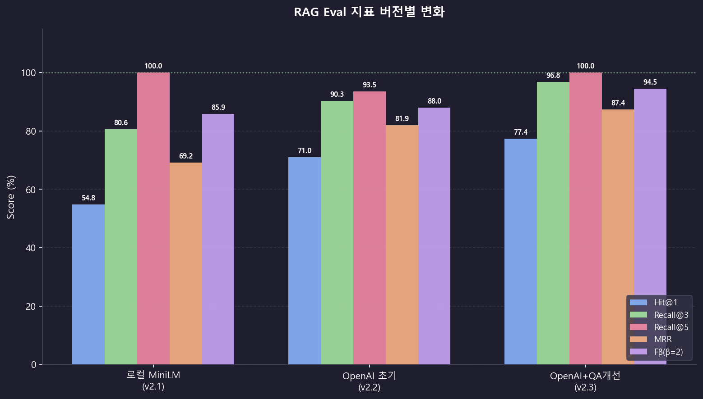

# RAG Eval 진행 리포트

**프로젝트**: LLM Wiki — RAG Retrieval Eval
**마지막 업데이트**: 2026-06-04
**임베딩 모델 (최신)**: text-embedding-3-small (OpenAI)
**QA 셋**: 31개

---

## 버전별 지표 변화

| 버전 | Hit@1 | Recall@3 | Recall@5 | MRR | Fβ(β=2) |
|------|-------|----------|----------|-----|---------|
| v2.1 (로컬 MiniLM) | 54.8% | 80.6% | 100.0% | 0.692 | 85.9% |
| v2.2 (OpenAI 초기) | 71.0% | 90.3% | 93.5% | 0.819 | 88.0% |
| **v2.3 (OpenAI+QA개선)** | **77.4%** | **96.8%** | **100.0%** | **0.874** | **94.5%** |

---

*`run_eval.py` 실행 시 자동 업데이트됨*
